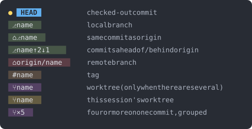

# git-graph

[한국어](README.md) | [English](README.en.md)

<p align="center">
  
</p>

A Claude Code mod that draws your repository's git graph, live, in a side pane next to the terminal.

`/plugin install git-graph@fromshim`

## Working with Claude

The graph sits right next to the conversation, so you can hand commits to Claude with a click and see what Claude and its subagents committed at a glance.

<p align="center">
  
</p>

- The card's `설명` (explain), `리뷰` (review) and `HEAD 와 비교` (compare with HEAD) buttons fill the prompt box with a sentence such as `커밋 a1b2c3d 을 리뷰해줘`. `체크아웃` (checkout) appears only on the card of a commit that is not HEAD. If one branch points at the commit, it fills a sentence asking to check out that branch; if several do, one asking which branch to use first; if none, one that notes a detached HEAD and asks first whether to create a new branch.
- Click a file line in the card to insert `@path` at the prompt cursor.
- Click the `커밋 안 한 변경 N개` (uncommitted changes) line to list the changed files; its `커밋 메시지 정리` (draft a commit message) button fills the prompt box with `지금 변경을 커밋 메시지로 정리해줘`.
- Press a chip (branch, remote, tag, worktree) and a list opens under that row: local branches (with their origin state), remote branches, tags and worktrees (path, uncommitted change count).
- The chip card has buttons too. A local branch line carries `체크아웃` (checkout; not on the branch this session has checked out), `pull` when it is behind origin, and `push` when it is ahead or has no upstream. A remote branch line carries `체크아웃`. The checkout and pull sentences make Claude ask first what to do with uncommitted changes.
- No button runs git. They only fill the prompt box with a sentence; edit it, then send. Nothing happens until you send.
- Turn on `원격 확인` (check remote) to run `git fetch` every 60 seconds and get a toast when origin gets new commits.
- Turn on `경로 강조` (highlight path) to gray out rows that are not ancestors of HEAD.

### What this session marks

<p align="center">
  
</p>

- `✦` goes before the subject of commits Claude made in this session. While a Bash tool call runs, if the HEAD of any worktree moves, the commits created in between are recorded. So commits a subagent made in another worktree get a `✦` too. The record keeps the latest 200, and one call reads at most 50 commits per worktree.
- There is a known limit: a commit made outside Claude, in another terminal, while a long Bash call runs can get a `✦` too.
- The record lives in the session's state and is not saved anywhere else. A new session starts empty, so commits made before it have no `✦`.
- Worktree chips show only when there is more than one worktree. This session's worktree is a yellow `⑂` chip; other worktrees (a subagent's, for example) are purple. With four or more worktrees on one commit, only this session's chip stays and the rest fold into `⑂ ×N`.
- In the chip card, a yellow `현재 세션` (current session) sits next to the branch this session has checked out and next to this session's worktree.
- This session's HEAD dot glows yellow.

## Features

- One row per commit. Lanes are computed from parent hashes, and each lane keeps its color for its whole life.
- Where several forks meet, link rows of their own keep the lines from running together.
- HEAD is drawn as `●`, every other commit as `┿`, `┯` or `┷`. The `●` is bright yellow, and in the terminal it glows softly on a 2.4-second cycle.
- When chips are wider than the row, the longest names are shortened in the middle with `…`. Chips that still do not fit fold into a gray `+N` chip; press it to open the card with the full names.
- Past 3 lanes the graph folds, and a button unfolds it.
- While you scroll, the top lines (fold, highlight-path and check-remote buttons, uncommitted count, HEAD) stay pinned above a `┊` gap.
- Click a commit hash to open its message and changed files (up to 30).
- Each row ends with an author chip, the short hash and a relative age (`2h`, `3d`, ...).
- Refreshes every 5 seconds and after each Bash tool call.
- `/git-graph` opens and closes the pane.

### Chip legend

Chips other than `HEAD` and the author chip are buttons on a dark tint of the chip's color.

<p>
  
</p>

| Chip | Meaning |
| --- | --- |
| `⎇ name` | local branch |
| `⌂⎇ name` | same commit as origin |
| `⎇ name ↑n ↓n` | commits ahead of / behind origin |
| `⌂ name` | remote branch |
| `# name` | tag |
| `⑂ name` | worktree (shown only when there is more than one) |
| `⑂ name` (yellow) | this session's worktree |
| `⑂ ×N` | the rest, grouped, when four or more worktrees sit on one commit |
| `+N` | chips that don't fit the row, folded |

## Install

Claude Code needs a build with hooks-module mods enabled (they sit behind a rollout switch); see Requirements and notes below.

Through the catalog:

```
/plugin marketplace add fromshim/marketplace
/plugin install git-graph@fromshim
```

Or standalone, from this repository:

```
/plugin marketplace add fromshim/git-graph
/plugin install git-graph@git-graph
```

## Requirements and notes

- A Claude Code version that supports hooks-module mods (developed on v2.1.292).
- Mods are behind a remote rollout switch, so they can be off in some environments.
- If drawing the pane fails, the pane shows the error and a toast says so. If no drawing request arrives within 5 seconds of opening the pane, that is toasted too.
- Colors assume a dark theme (Atom One Dark).
- Only plain Unicode is used; no Nerd Font needed.

## Development

```
claude plugin validate .
claude plugin test .
```

Regenerate the preview: run `npx -y tsx scripts/preview.ts` from the repo root to redraw the SVGs in `assets/` with the `core/` layout. `scripts/flow.sh` builds `assets/flow.gif` with Chrome and ffmpeg.

### Structure

- `core/` is pure TypeScript: no dependencies, no Node or DOM APIs, no JSX, no import of `claude-code`. It takes git output strings and returns data.
  - `ancestry.ts` HEAD ancestry and graying
  - `changes.ts` uncommitted-changes parsing
  - `commands.ts` git argv arrays and the separator
  - `layout.ts` lane layout and folding
  - `mine.ts` commits made in this session
  - `prompt.ts` the texts the buttons put in the prompt box
  - `pulse.ts` frames of the HEAD dot's glow
  - `refs.ts` chips, tracking, worktrees, relative age
  - `remote.ts` detecting a growing behind count
  - `show.ts` `git show` parsing
  - `theme.ts` color palette and chip tint
- `hooks/register.tsx` is the Claude Code UI only: hooks, pane rendering, refresh and fold wiring, and running git (`$.process.run`).
- The split exists so `core/` can be reused by a future `cli/` (Node) and `app/` (GUI). Neither exists yet; both are planned.

## License

MIT
